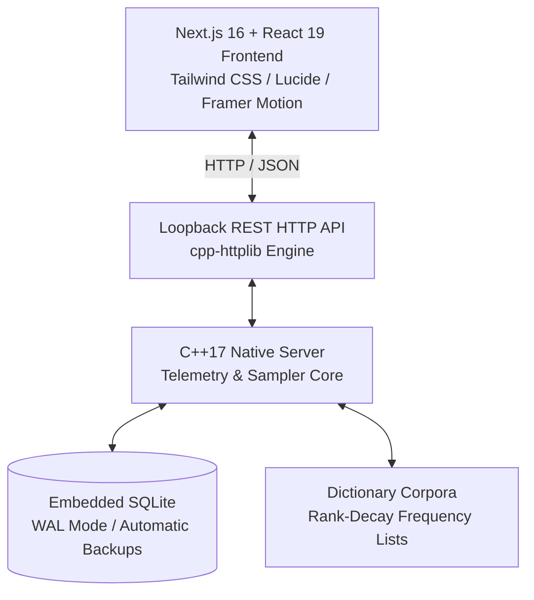

<div align="center">

# ⚡ TypeX
### High-Performance Native Typing Platform & LAN Stage Tournament Engine

[](https://github.com/RehanSajid136602/TypeX/releases)
[](LICENSE)
[](https://github.com/RehanSajid136602/TypeX/releases)
[](backend/)
[](frontend/)
[](backend/)

<p align="center">
  <b>Engineered by <a href="https://github.com/RehanSajid136602">Rehan Sajid</a></b>
</p>

<p align="center">
  <a href="#-key-features">Key Features</a> •
  <a href="#-download--installation">Download & Install</a> •
  <a href="#-local-user-profiles--analytics">Analytics</a> •
  <a href="#-lan-stage-tournaments">LAN Tournaments</a> •
  <a href="#-architecture">Architecture</a> •
  <a href="#-license--attribution">License</a>
</p>

---

</div>

## 📖 Overview

**TypeX** is an ultra-minimalist, 120fps fluid typing benchmark, motor-learning suite, and LAN stage tournament platform. 

Combining a zero-overhead **C++17 native engine** with a reactive **Next.js 16 App Router (React 19 / TypeScript / Tailwind CSS)** presentation layer, TypeX guarantees deterministic word generation, millisecond-accurate keystroke telemetry, and offline-first data sovereignty.

Whether you are training finger biomechanics with adaptive rank-decay word samplers or broadcasting multi-seat esports typing tournaments across an arena projector, TypeX delivers state-of-the-art performance with zero external cloud dependencies.

---

## ✨ Key Features

- 🏎️ **120fps Kinetic Arena**: Smooth multi-line rolling word display that scrolls continuously without paragraph breaks.
- 🎯 **Keybr-Style Adaptive Curriculum & Target Speed Gate (`learn` mode)**:
  - Guided curriculum key order: `e, n, i, t, r, l, s, a, o, d, y, c, h, g, m, u, p, b, k, v, w, f, z, x, q, j` (starts with top 6 keys).
  - Strict containment guarantee: learners never see locked characters.
  - Order-4 Phonetic Markov Generator for early lessons when $< 15$ matching real words exist.
  - Keybr speed-first gate: 35.0 WPM target speed ($\ge 1.0$ speed confidence) with a 95% accuracy guardrail ($\ge 20$ samples).
  - Multi-track learning support: Phonetic Unlock, Trigram Chunks, SFB Destroyer, Finger Gym, and C++ Symbols.
  - Spaced repetition queue for missed tokens.
- 🧘 **Distraction-Free Focus Mode**:
  - Automatically hides all UI chrome on typing start.
  - Survives drill transitions and idle pauses without flashing the screen.
  - Restored only on deliberate swipe gestures ($\ge 80\text{px}$ in $\le 300\text{ms}$) or the Escape key.
- 👤 **Offline User Profiles & SQLite Storage**:
  - Completely local persistence using an embedded SQLite WAL database.
  - Multi-profile management, instantaneous switching, and Guest Mode.
  - Automatic zero-lock online database backups and disaster-recovery safeguards.
- 📈 **Comprehensive Analytics Dashboard (`/account`)**:
  - Detailed telemetry charts for Net WPM, Raw WPM, Accuracy, and Consistency.
  - Rolling 10-test averages, streak trackers, speed histograms, and GitHub-style 12-week activity tiles.
  - Professional single-click **CSV** and multi-sheet **XLSX** exports with formula injection defense.
- 🏟️ **LAN Stage Competition Engine (`/compete`, `/admin`, `/leaderboard`)**:
  - Host live tournaments on your local network (`--host 0.0.0.0`).
  - Salted SHA-256 Master Admin PIN security with batch synchronization.
  - Dedicated widescreen 16:9 scoreboard projector display with real-time sub-batch reveals.
- 🖥️ **First-Class Desktop Installers**:
  - **Windows**: Single standalone setup installer (`TypeX-Setup.exe`) with EULA agreement, Program Files installation, desktop shortcuts, and zero terminal pop-up (`-mwindows` GUI subsystem).
  - **Linux**: Official standalone `.deb` package for Ubuntu 22.04/24.04 and Debian 12 amd64.

---

## 📥 Download & Installation

Pre-compiled, standalone desktop installers are available on the [**GitHub Releases**](https://github.com/RehanSajid136602/TypeX/releases/tag/v0.1) page.

### 🪟 Windows Setup (Single `.exe` Installer)
1. Download [**`TypeX-v0.1-Setup.exe`**](https://github.com/RehanSajid136602/TypeX/releases/download/v0.1/TypeX-v0.1-Setup.exe).
2. Double-click the installer, accept the License Terms, choose your installation directory (defaults to `C:\Program Files\TypeX`), and click **Install**.
3. Launch **TypeX** from your Desktop or Start Menu. TypeX launches directly as a native Windows application without opening any terminal or command prompt window.

> **Data Location**: User databases and profiles are safely isolated in `%LOCALAPPDATA%\TypeX\typex.db`.

---

### 🐧 Linux Setup (`.deb` Package)
TypeX supports **Ubuntu 22.04 LTS, Ubuntu 24.04 LTS, and Debian 12 (Bookworm) amd64**:

1. Download [**`typex_0.1_amd64.deb`**](https://github.com/RehanSajid136602/TypeX/releases/download/v0.1/typex_0.1_amd64.deb).
2. Install via `apt` to automatically resolve system dependencies (`libwebkit2gtk-4.1-0`, `libgtk-3-0`, `libc6`):
   ```bash
   sudo apt install ./typex_0.1_amd64.deb
   ```
3. Launch TypeX from your application launcher or terminal:
   ```bash
   typex
   ```

> **Data Location**: User databases are safely isolated in `~/.local/share/TypeX/` (honors `$XDG_DATA_HOME`). Package updates or removals will **never** overwrite or delete your profile history.

---

## 👤 Local User Profiles & Analytics

TypeX prioritizes user privacy and offline security:
- **Zero Cloud & Zero Telemetry Pings**: All telemetry and personal typing records remain on your local disk.
- **Embedded SQLite WAL Engine**:
  - Full ACID compliance, foreign key validation, and non-destructive schema migrations.
  - Automated database backup snapshots created in `backups/`.
- **Account Dashboard (`/account`)**:
  - **Metrics**: Personal Bests, Rolling Averages, Biomechanical Hand & Finger Balance.
  - **Visualizations**: Net WPM Over Time, Accuracy Curves, Speed Histograms, ANSI 60% Error Heatmap.
  - **Exporting**: Export to UTF-8 BOM CSV or real multi-sheet Excel `.xlsx` files with formatted summaries, key flight-times, and error registers.

---

## 🏆 LAN Stage Tournaments

TypeX includes a complete tournament management suite built for stage events, school hackathons, and esports competitions:

1. **Host Launches TypeX in Host Mode**:
   ```bash
   typex --host 0.0.0.0
   ```
2. **Projector Screen**:
   - Open `/leaderboard` on an external display or projector. Press **Fullscreen** for a sleek 16:9 widescreen scoreboard with real-time ranking reveals.
3. **Contestant Stations**:
   - Participants connect over local Wi-Fi / LAN to `http://<HOST_IP>:<PORT>/compete` and enter their Contestant Details.
4. **Admin Cockpit (`/admin`)**:
   - The Stage Director logs in using their Master Admin PIN, selects paragraph corpora, configures batch sizes, and commands live rounds.
   - **Security Guarantee**: Personal typist profiles (`/api/accounts/*`) strictly reject non-loopback connections (`403 Forbidden`). LAN contestants cannot view or modify the host's personal history.

---

## 🛠️ Architecture & Tech Stack



- **Frontend**: Next.js 16 (App Router), React 19, TypeScript, Tailwind CSS, Lucide Icons, Framer Motion.
- **Backend**: C++17, `cpp-httplib`, `nlohmann/json`, raw SQLite3 amalgamation.
- **Packaging**: NSIS (Nullsoft Scriptable Install System) for Windows, Debian package builder (`dpkg-deb`) for Linux.
- **CI/CD**: GitHub Actions cross-compilation pipeline with MinGW-w64 and GCC.

---

## 💻 Local Development Workflow

To clone and run TypeX locally from source:

```bash
# 1. Clone repository
git clone https://github.com/RehanSajid136602/TypeX.git
cd TypeX

# 2. Start full-stack local dev environment (backend on :8080, frontend on :3000)
./start.sh
```

Visit [**http://localhost:3000**](http://localhost:3000) in your browser.

---

## 📜 License & Mandatory Attribution

This project is open-source software licensed under the **MIT License with Mandatory Attribution**.

### Terms of Use:
- **Free to Use**: You are free to download, use, modify, study, and integrate TypeX into personal or commercial workflows.
- **Mandatory Attribution**: Any redistribution, modification, public deployment, showcase, or derivative fork of this software **MUST prominently and visibly mention and attribute the original author**:
  
  > **Original Author:** **Rehan Sajid** ([@RehanSajid136602](https://github.com/RehanSajid136602))  
  > **Project Repository:** [https://github.com/RehanSajid136602/TypeX](https://github.com/RehanSajid136602/TypeX)

See the full [**LICENSE**](LICENSE) file for complete legal details.

---

<div align="center">
  <sub>Developed with precision by <a href="https://github.com/RehanSajid136602">Rehan Sajid</a>. Contributions and issue reports are welcome!</sub>
</div>
